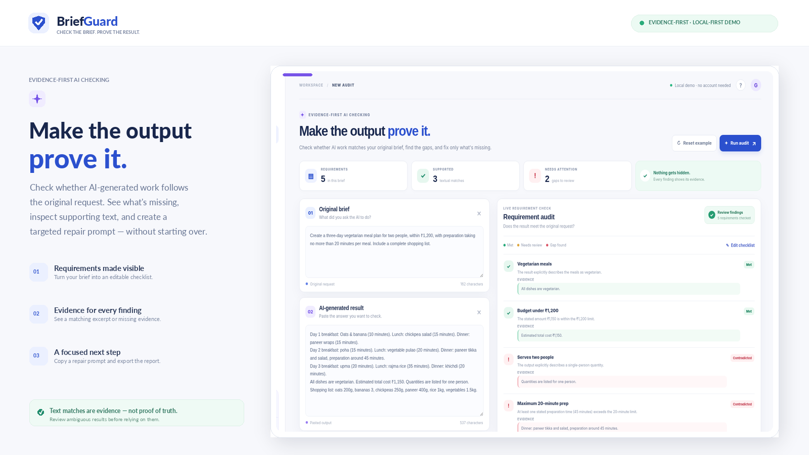

# BriefGuard

**Check the brief. Prove the result.**

BriefGuard is a small, local-first web app that checks whether an AI-generated answer appears to satisfy the user's original request. It surfaces likely matches, explicit contradictions, missing evidence, and a targeted repair prompt that can be copied into the user's usual AI tool.



> **Prototype honesty note:** this version uses transparent, rule-based text checks in the browser. It does not call an LLM, validate facts against the web, or prove that a matching sentence is true. Some findings deliberately say “Needs review.” Treat this as an evidence-first checklist tool, not an oracle.

## Try it locally

**Requirements:** Node.js 18 or newer. No npm install is needed; there are no runtime dependencies.

```bash
npm start
```

Open <http://localhost:4173> in a browser. The sample is preloaded, so the first screen is already interactive. Click **Run audit** to rerun the checks.

Alternatively, open `index.html` directly in a modern browser. Clipboard support is best over `http://localhost` because browsers restrict clipboard access from local files.

## What works

- Preloaded, end-to-end demo with a deliberately flawed meal-plan result.
- Editable original brief and generated output.
- Checklist extraction for common explicit constraints (diet type, budget, servings, time limits, shopping list) plus a generic fallback.
- Evidence excerpt for every result, with status labels: **Met**, **Missing**, **Contradicted**, or **Needs review**.
- Editable checklist, targeted repair-prompt generation, copy-to-clipboard, and Markdown report export.
- Local browser processing; no account, API key, or external model call.
- Responsive UI and a visible trust/limitations section.

## Run a useful test

1. Leave the sample brief and output unchanged.
2. Click **Run audit**.
3. Confirm the vegetarian, budget, and shopping-list requirements are marked as met.
4. Confirm the two-person servings and 20-minute preparation requirements are flagged as contradicted by the sample output.
5. Inspect the evidence under those findings.
6. Copy the targeted repair prompt, then export the Markdown report.
7. Replace the output text with a compliant answer and run the audit again.

The expected sample result is illustrative and deterministic. Custom briefs use basic heuristics and should be reviewed by a human.

## Project structure

```text
briefguard/
├── index.html                 # App interface
├── styles.css                 # Responsive design system
├── app.js                     # Browser-side audit logic
├── server.mjs                 # Tiny Node static server (no dependencies)
├── package.json
├── assets/
│   ├── briefguard-cover.png   # Project cover / hero art
│   └── app-screenshot.png     # Captured running interface
├── scope.md                   # Draft; replace/verify via official skill pack
├── prd.md                     # Draft; replace/verify via official skill pack
├── spec.md                    # Draft; replace/verify via official skill pack
└── LICENSE
```

## How the audit works

BriefGuard maps recognizable constraints to transparent rules. The bundled demo checks dietary language, currency amounts, portion-size phrases, preparation-time mentions, and shopping-list language. Generic requirements use configurable signal phrases and produce conservative text-match statuses. The repair prompt lists requirements that were not marked “Met” and reminds the next AI response to preserve the constraints that were satisfied.

This is intentionally scoped as a small proof of concept. It does **not** establish whether the listed food is truly vegetarian, whether a price estimate is accurate, whether a meal really takes the stated amount of time, or whether the response is semantically complete. Users should review the supporting text and any consequential output themselves.


## License

MIT. See [`LICENSE`](LICENSE).
